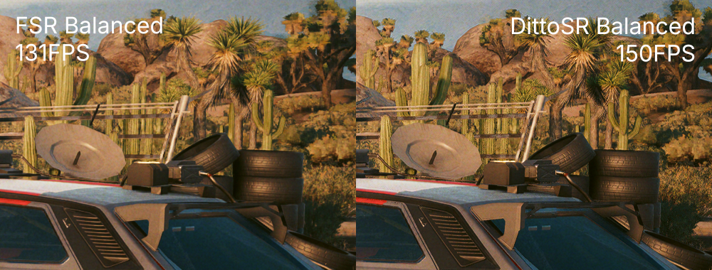

<p align="center"></p>
<p align="center"><a href="https://buymeacoffee.com/vancete"></a></p>

# DittoSR

DittoSR is a temporal upscaler for PC games. It started from Qualcomm's **Snapdragon Game Super Resolution 2** (GSR 2),
a light upscaler made for phones, and was reworked heavily to hold up in demanding PC games (dense foliage, fast camera
turns, high ratios) while staying lighter than the usual alternatives. Thought for handheld PCs while also working pretty great on high-end PCs!

It ships as a drop-in **FidelityFX API** provider for **DirectX 12 and Vulkan**: a game that offers FSR 3.1 upscales
through DittoSR instead, with no change to the game. For games whose FSR it can't reach, it can also take **XeSS**'s
place on DirectX 12.

You can expect a perceived quality between FSR 3.1 and FSR 4.1 while being lighter than both. A small `dittosr.ini`
next to the DLL sets the sharpness and the frame blending, reloaded live with **F9**.



## Install

### With the loader (recommended)

Extract `DittoSR.zip` and run **`DittoSRLoader.exe`**:

1. Pick the game in the **Steam game** list, or **Browse...** to its folder (the install folder is enough: the loader looks below it).
2. Under **Replace**, choose **FSR** (the default) or **XeSS**.
3. The DLLs to replace are found and checked for you. **Install DittoSR**, then choose FSR (3.1 or later) or XeSS in the game's settings.

**Restore game's files** puts the originals back, **Settings** sets the sharpness and frame weight, and **Log** opens
`dittosr.log`. The game's DLLs are checked for AMD's or Intel's signature and backed up to `dittosr-backup\` before
anything is replaced.

### With OptiScaler

OptiScaler v10 (recent nightly builds) loads custom FidelityFX providers. The loader finds it (and its version) when
scanning the game: an **OptiScaler** button appears before FSR and XeSS, and installs DittoSR as its custom provider
(DirectX 12 and Vulkan) without touching the game's files. By hand, copy `build\amd_fidelityfx_dx12.dll` from the zip
into OptiScaler's own folder (the `OptiScaler` folder next to the game's executable, if there is one) as:

```
custom\DittoSR\ffx\amd_fidelityfx_dx12.dll
```

DittoSR then shows up in OptiScaler's upscaler list. A `dittosr.ini` in the same folder is optional (the defaults apply without it).
OptiScaler's settings drive it:

- **Sharpness** (with Override on): DittoSR's sharpness, the same scale as the ini's (0.6 as reconstructed). 0 means
  "no sharpening" to OptiScaler, so DittoSR then keeps the ini's value: use 0.01 for the softest.
- The FSR 3 **presets** set the frame weight: **Stability** 1, **Default** the ini's (2), **Motion** 3. By hand, the
  **Velocity Factor** below 1 is steadier (weight 2 x it), and at 1 the **Reactive Scale** below 1 more responsive
  (up to 4).

### With the scripts

`scripts\install.ps1 -Dir "<folder>"` and `scripts\uninstall.ps1 -Dir "<folder>"` do the same as the loader on FSR.
On **SteamOS and Linux (Proton)**, `bash scripts/install.sh <app id or folder>` and `scripts/uninstall.sh` (not yet
tested; leave `PROTON_FSR4_UPGRADE` off).

### Notes

- **XeSS mode**: some games, such as Cyberpunk 2077, build their FSR into the executable, so DittoSR never gets an upscale to do. If the game offers XeSS on DirectX 12, install on **XeSS**: DittoSR's `libxess.dll` runs the upscale and forwards everything else to the game's own XeSS (kept as `libxess_orig.dll`).
- **AMD's DLL**, kept as `.orig.dll`, keeps frame generation working, and with `[debug] enabled=1`, **F10** switches between DittoSR and AMD's FSR live.
- **Online games:** don't. Replacing a game's DLLs can trigger anti-cheat systems.

## What it does

Each frame, four compute passes run on the game's command list:

| Pass           | Size   | What it does |
| -------------- | ------ | ------------ |
| `convert.hlsl` | render | GSR 2's convert pass: the motion of the nearest of the 3x3, the depth for the disocclusion test, and how much of the image changed (scene cuts settle at once) |
| `motion.hlsl`  | render | the motion checks (an object's motion against its neighbours', disocclusion) and a reactive mask when the game gives none |
| `upscale.hlsl` | output | the jittered samples through an edge-directed Gaussian, blended with the history moved along the motion vectors and clipped against the samples |
| `sharpen.hlsl` | output | a light contrast-adaptive sharpen |

What changed from GSR 2's upscale, in short:

- **A per-pixel stability level**: a pixel stable for a few frames takes less of each new frame and stops shimmering; one whose history was just cut converges as fast as before.
- **The new frame's share follows how close its jittered samples landed**, and drops where the difference from the history keeps flipping sign (aliasing rather than change).
- **Disocclusion from the previous frame's depth** instead of GSR 2's depth clip, which cut the history at every depth edge and made foliage noisy.
- **The history is clipped by its low frequencies only**, so the detail it has accumulated survives the current frame's aliasing.
- **The history's resampling blur is made up in motion**: moved by a fraction of a pixel each frame, its detail would otherwise soften frame after frame.
- **An HDR encoding** (Reinhard, then a square root) so blends behave in a perceptual domain.

On integrated GPUs the history is stored as RGB10A2 (`history_10bit`, on by default) and, up to 2.5x, the sharpening
runs inside the upscale instead of a pass of its own (`fused_sharpen`). Half precision (`fp16`) is off by default: on
the ROG Ally it was slower than full precision. The Vulkan path runs the same passes from the same HLSL, with only Vulkan 1.1 core: its
history is RGBA16F and its shaders FP32.

## Results

### Cyberpunk 2077 (in game)

RTX 5070 Ti, 3840x2160 output, render 1670x939 (2.3x), the same view: **DittoSR 174 fps, FSR 146–148 fps.**

### Offline harness

A synthetic HDR scene upscaled to 1440x810 through the FidelityFX API, so DittoSR and AMD's FSR 3.1.5 take exactly the
same inputs (`test/harness.cpp`). PSNR is against a 4x4-supersampled reference; shimmer is the mean difference between
consecutive frames once the pan is undone (lower is steadier). XeSS 2.0.1 was measured through its own API with the same scenes.

| Scene                                        | DittoSR               | AMD FSR 3.1.5         | Intel XeSS 2.0.1      |
| -------------------------------------------- | --------------------- | --------------------- | --------------------- |
| Dense grass, still, 2x                       | 34.6 dB, shimmer 1.44 | 32.4 dB, shimmer 1.02 | 36.4 dB, shimmer 1.51 |
| Dense grass, pan 3 px/frame, 2.3x            | 32.0 dB, shimmer 1.24 | 31.4 dB, shimmer 5.08 | 34.4 dB, shimmer 3.25 |
| Dense grass, uneven pan 12 ± 3 px/frame, 2x  | 32.5 dB, shimmer 1.96 | 30.3 dB, shimmer 9.02 | 34.7 dB, shimmer 3.09 |
| Moving object over a detailed background, 2x | 28.4 dB               | 28.7 dB               | 30.7 dB               |

In short: steadier than FSR 3.1.5 and XeSS on foliage in motion and sharper than FSR on foliage, while XeSS still
resolves more fine detail.

### GPU time

The upscale's GPU time (`scripts\bench.ps1`, the median of 400), RTX 5070 Ti:

| Output    | FSR Quality (1.5x) | FSR Performance (2x) |
| --------- | ------------------ | -------------------- |
| 1920x1080 | 0.20 ms            | 0.19 ms              |
| 2560x1440 | 0.35 ms            | 0.33 ms              |
| 3840x2160 | —                  | 0.75 ms              |

## In-game menu

**F7** opens a side panel on the left of the game (DirectX 12): DittoSR's GPU time and the frame time as a graph, the upscaler
(DittoSR or the game's own, and the side-by-side comparison), sharpness, frame weight, anti-shimmer, motion detail, auto
reactive, the debug views and the indicator. Changes apply at once; **Save** writes them to
`dittosr.ini` (only what differs from the defaults, besides sharpness and frame weight), **Defaults** restores the
defaults, **Revert** reads the file again.

Arrows select and adjust, Enter resets a slider to its default or switches an option, Backspace or F7 closes it. While
it is open the arrows and Enter don't reach the game; where the game shows a mouse cursor, the panel takes clicks and
drags too. `menu_key` changes the key (`0`: no menu).

## Settings (`dittosr.ini`)

**F9** reads the file again while playing.

| Section     | Key            | Meaning |
| ----------- | -------------- | ------- |
| `[dittosr]` | `version`      | the DittoSR version the file was written for: the loader and the install scripts update older settings by it |
| `[dittosr]` | `enabled`      | `1` DittoSR; `0` AMD's FSR instead (needs AMD's DLL alongside as `.orig.dll`) |
| `[dittosr]` | `sharpness`    | `0` soft, `0.6` (default) as reconstructed, `1` sharpened |
| `[dittosr]` | `frame_weight` | each new frame's weight, 0.25 to 4 (default 2): lower is steadier and smoother, higher is crisper in motion with more shimmer |
| `[debug]`   | `enabled`      | `1`: F10 switches DittoSR ↔ AMD's FSR live, and the log describes the first upscales in full |
| `[debug]`   | `indicator`    | `1`: a small pink DittoSR face in the top-left corner while DittoSR upscales |

`dittosr.log`, next to the DLL, records the context's creation and `DittoSR ran (frame 1)`.

**Advanced keys**, not in the shipped file but read from `[dittosr]` when added (`src/dittosr.h` describes each with its default):

- `ratio_quality`, `ratio_balanced`, `ratio_performance`, `ratio_ultra_performance`: the ratio each quality mode gets (1 to 4), e.g. `ratio_ultra_performance=2.5`. FidelityFX API only.
- `compare=1`, the menu, or a key of its own (`compare_key`, none by default): DittoSR on the left half, the game's own upscaler on the right (needs the game's DLL alongside).
- `menu_key` (`0x76`, F7; `0` off): the in-game menu's key.
- `anti_shimmer` (0.4 up to 2x, 0.2 at 3x, DirectX 12; `0` off), `auto_reactive` (0.5; `0` off), `stab_step`: steadiness against responsiveness.
- `history_sharpen` (1; `0` off): how far the history's resampling blur is made up in motion (fine moving detail).
- `history_10bit`, `fp16`, `fused_sharpen` (1; `0`: the separate sharpening pass): performance (see above).
- `game_sharpness`: the sharpness sent with the upscale call in place of the ini's: `-1` (default) only from OptiScaler's custom folder, `1` always, `0` never.
- `toggle_key`, `reload_key`, `debug_view`, `log_dispatches`: diagnosis.
- The reconstruction's knobs: `width`, `conf`, `share_far`, `share_near`, `alpha_rest`, `gamma_rest`, `motion_gamma`, `motion_share`, `motion_minmax`, `motion_near`, `split_clip`, `react`, `change_scale`, `exposure_scale`, `encode_power`, `reactive_scale`, `jitter_sign_x`, `jitter_sign_y`, `mv_sign`.

## Build

Needs Visual Studio 2022 (C++ tools), the Windows SDK's `dxc`, and a `dxc` with SPIR-V for the Vulkan shaders: extract
the [DirectXShaderCompiler release](https://github.com/microsoft/DirectXShaderCompiler/releases) into `tools\dxc\`, or
install the Vulkan SDK. Then:

```bat
build.bat
```

`build\` gets the DLL under the names games load (`amd_fidelityfx_dx12.dll`, `amd_fidelityfx_loader_dx12.dll`,
`amd_fidelityfx_vk.dll`), `libxess.dll`, `harness.exe` and `DittoSRLoader.exe`. `scripts\package.ps1` packs them into
`build\DittoSR.zip`.

`build\harness.exe <folder> <png prefix> [key=value ...]` runs the offline test against the DLL in `<folder>`; its
options (scenes, ratio, speed, the GPU) are listed at the top of `test/harness.cpp`.

## License

DittoSR is MIT-licensed ([LICENSE](LICENSE)). It derives from Snapdragon GSR 2 (BSD 3-Clause). See
[THIRD-PARTY-NOTICES.md](THIRD-PARTY-NOTICES.md) and `licenses/`.
